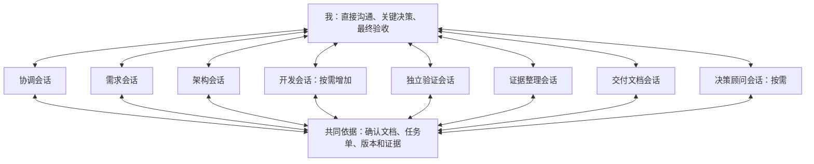

# 开发架构设计

整理日期：2026-11-05。

## 一、我怎样组织这个项目

我用多个职责明确的 Agent 协助开发，但产品方向、重要取舍和最终验收由我负责。需求、架构、开发、验证、证据整理、文档和决策咨询分别有直接对话入口；协调 Agent 帮我维护全局状态，决策顾问帮我分析方向和取舍，不代替我作决定。

课程的硬性要求只看同目录的 [作业要求.md](作业要求.md)，产品目标和业务决定看 [产品构想.md](产品构想.md)。这份文档规定我的协作方式，课程材料与参考书只提供方法，不额外增加评分要求。我的后续明确修正优先于早期建议。

我通过 `grill-me` 访谈逐步确定这套方案，整体核对后整理。角色和流程已经选定，但 TRAE 配置、协作实验和产品功能尚未因此完成。原截图规则的人工操作、提醒、编号、归档和写作要求已合并到第九节，项目内无需再依赖另一份截图规则文件。

TRAE 的工作根目录是项目目录。课程目录下的 `project/` 目前通过软链接指向 `/home/wordwoods/Projects/Tride`；这里的三份文档随项目保存、相互使用相对链接，课程材料仍在原处。本文不确定后续源码目录和产品技术栈，也不创建角色配置。

我在 2026 年 11 月 23 日提交课设，总投入少于 30 小时，包含开发、测试、取证、报告和提交。如果验证表明时间和范围冲突，由我确认调整本次交付范围，记录原因、改了什么和影响；完整产品方向和真实失败记录保留。

我确认关键决策和每个增量的验收，已授权范围内的实现、测试和常规修复可以连续进行，不逐行审批。公开发布、仓库上传等外部操作按我的实际授权执行，写在计划中不等于已经获准或完成。

## 二、开发过程模型及选择依据

采用**增量迭代为主、关键风险提前验证、保留阶段验收和全过程证据**的过程模型。

### 2.1 增量与迭代的职责

- **增量**：每轮形成新增的、可运行和可验收的使用能力。切分应尽可能贯通相关界面、业务和存储，不以“数据库全部完成”“页面全部完成”代替可用流程。
- **迭代**：依据实际使用、运行和测试反馈，修正已有需求细节、设计与实现。产品方向已经明确，不因仍有细节待设计就将整个项目认定为需求模糊。
- **风险驱动验证**：对可能改变技术路线或交付可行性的能力，先用小实验取得证据。产品构想中提醒、计时恢复、AI 写入与撤销等仍待验证；具体实验顺序在后续设计中按影响确定。
- AI 生成后的“评审—修正”是局部工作循环，不能单独作为整个生命周期采用增量模型的理由。

### 2.2 选择与裁剪

| 项目特征 | 对过程的影响 |
| --- | --- |
| 范围较广、投入有限，整体交付可行性尚未验证 | 用可运行增量及验收结果决定后续投入；范围变更仍由我确认 |
| 先服务本人真实流程，体验与建议有效性需要使用反馈 | 保留原型与迭代修正的空间 |
| 部分关键能力存在未验证风险 | 借鉴螺旋模型的风险分析与前置验证，不为每个普通功能套用完整风险循环 |
| 一人负责，AI 承担不同专业工作 | 保留目标、任务、评审和回顾，裁剪完整 Scrum 角色与会议机制 |
| 产品调用云端模型，目前没有训练模型的需求 | 验证模型行为、工具执行与数据依据，不预设数据标注和训练流水线 |
| 课程要求全过程留证与版本对应 | 各阶段同步留证和积累报告材料，不在结尾补造过程 |

整体一次完成后才获取反馈，会推迟体验和集成问题的发现；瀑布式顺序可以用于已经稳定的小功能。增量迭代本身也存在局部一致、整体失配以及反复打磨耗尽预算的风险，需通过共享规则、接口约定、回归检查与范围管理控制。我仍需要通过早期验证判断范围是否可交付，采用这个模型本身并不能保证按时完成全部目标。

## 三、独立会话与我的参与方式

采用**核心角色独立对话、项目文档与任务单交接、协调 Agent 辅助统筹**的组织方式。

1. 在 TRAE 中为每类核心角色新建独立任务对话，并选择相应智能体或配置职责。Agent 是角色配置，会话是工作实例；不把同一对话内切换 Agent 视为建立了独立上下文。
2. 我可以直接进入任一角色会话，追问依据、补充要求、纠正理解或停止工作。关键沟通无需全部经过协调 Agent 转述。
3. 协调 Agent 维护全局任务与待决事项，它的摘要不能取代原始产出、运行证据或我的决定。
4. 角色按阶段和任务调用，不要求所有会话同时运行。已有需求与设计可以复用，小修改只启动受影响角色。
5. 子 Agent 作为可选扩展，用于边界清楚的检索、分析或检查任务；不以主 Agent 自动调用子 Agent 取代核心角色的直接沟通入口。
6. 跨会话启动与转交先由我执行，协调 Agent 准备简短交接指令。不预设 TRAE 能自动向任意已有角色会话发送消息，不为此额外开发自动路由系统。
7. 会话独立不等于文件工作区隔离。提示词中的修改边界也不能在未经验证时表述为强制权限隔离。



图中连接表示沟通与产物读写关系，不表示已经实现 Agent 之间的自动消息投递。

## 四、八类角色与权限

| 角色 | 主要职责与产出 | 修改和决策边界 |
| --- | --- | --- |
| 协调 Agent | 维护阶段、任务依赖、负责人、状态与待决事项；准备交接指令，组织集成、验收和交付核对 | 维护协调记录，不自行改变需求、关键架构或验收标准；不代替开发负责人实施集成，也不代替我验收 |
| 需求 Agent | 直接与我澄清场景、业务规则、范围和验收条件；形成需求草案，分析变更 | 维护需求产物；确认后的变更由我批准，不能根据实现困难自行删除功能 |
| 架构 Agent | 比较候选方案，设计模块职责、接口、数据模型和风险验证计划，分析变更影响 | 维护设计产物；重要取舍交我确认，不把技术偏好改写成需求 |
| 开发 Agent | 按确认设计实现、自测和修复；提交修改说明、代码版本、运行结果与遗留问题；指定的一位开发负责人承担集成 | 修改任务单允许范围内的业务代码与开发测试；跨模块接口或关键方案变化先交回判断 |
| 独立验证 Agent | 在需求、架构、增量验收节点审查；补充测试与反例，执行检查及复测，输出实际结果 | 可以补充和修正测试，不修改业务代码；修正自身测试错误需记录依据，验收标准变化由我确认 |
| 证据整理 Agent | 实际查看、编号和归档真实截图与记录，维护指令、问题、验证、版本和报告引用的关联，列出待补证项 | 不修改业务代码，不编造经历或验收结论，不替我完成实际截图；保留原图，报告副本检查脱敏 |
| 交付文档 Agent | 依据确认产物、实际版本、验证结果和证据索引，整理 README、运行说明和课程 Word 报告 | 维护交付文档；不把目标写成完成状态，不编造个人判断；个人总结由我提供或确认，结论交独立验证核对 |
| 决策顾问 Agent | 按需与我讨论方向、优先级、范围和投入取舍；核实依据、质疑假设、比较方案，给出明确建议及会改变建议的证据 | 不增加固定审批关卡，不自行修改需求或架构基线、调度开发、批准验收或替我作决定；我确认后，由对应负责人更新文档，协调 Agent 跟进执行 |

需求、架构、协调记录、证据索引和交付文档分别有明确负责人。其他角色先提出修改建议，由负责人更新，避免同时覆盖。角色名称不等于自动获得对应工具权限，具体配置与实际行为须验证。

### 4.1 哪些事需要我确认

- 需求范围、重要业务规则和验收标准。
- 整体架构及后续关键架构变更。
- 交付范围变化、预计突破投入上限以及暂停问题的后续处理。
- 每个增量的验收、最终发布与课程交付结论。

已授权增量内的实现、自测、独立验证与常规修复可按任务推进，不逐行审批。公开发布、仓库上传及其他外部操作仍按实际授权执行；本文不代表这些操作已经获准或完成。

### 4.2 我怎样使用决策顾问

遇到重大分歧、范围取舍、投入风险，或某个问题暂停后需要决定怎么办时，我可以找决策顾问讨论。平时按需使用，不要求每个需求、设计和增量都再经过它审查，也不因此增加一个审批人。

需求 Agent 帮我明确产品应该满足什么、怎样验收；架构 Agent 分析怎样实现；协调 Agent 安排已经决定的工作；独立验证检查是否符合要求。决策顾问关注的是：是否值得做、先做什么、投入到什么程度。

讨论时，先读取当前目标、约束、实际进度和相关原始材料，明确这次要作的决定，区分事实、假设和我的偏好。能查证的事实先核实，信息不足就提出最小验证办法，不凭空估算工作量或泛泛比较。

我希望它能质疑我的想法和其他 Agent 的方案，同时给出有依据的推荐。默认按下面的顺序说明：

1. 当前决策：究竟需要决定什么。
2. 判断依据：已知事实、关键假设和缺失信息。
3. 方案比较：少量可行方案的收益、成本、风险、机会成本与可逆性。
4. 明确建议：推荐什么、为什么，以及什么新证据会改变建议。
5. 下一步：直接决定，还是先做一个小验证。

例如，两轮修复仍失败后，验证 Agent 提供失败事实，开发和架构 Agent 分析原因与修复方案，协调 Agent 汇总进度、依赖与剩余投入。需要时，我再请决策顾问比较继续修复、改变方案或推迟功能的代价。最终由我决定，相关角色随后更新和执行，不能把顾问建议直接当成已经批准的变更。

## 五、覆盖生命周期的工作流

| 阶段 | 主要输入与产出 | 通过条件与责任 |
| --- | --- | --- |
| 需求基线 | 根据产品构想形成场景、范围、业务规则、验收标准与未决事项 | 验证 Agent 检查矛盾、遗漏和可验收性；影响当前设计的歧义已明确，由我确认 |
| 整体架构与风险验证 | 根据确认需求形成候选方案比较、共享规则、模块与关键数据流、风险实验结果 | 验证 Agent 检查需求覆盖与验证方法；阻断风险已解决，或我已明确选择调整方案，再确认设计 |
| 增量开发循环 | 细化当前增量的需求与设计，明确任务和依赖，完成初始实现、自测、修复、集成与独立验证 | 本轮标准达到，相关回归通过，遗留问题如实记录；由我验收。未通过不能仅因 Agent 声称完成而转为已完成 |
| 发布与课程交付 | 实际产品或安装包、README、启动与使用说明、Gitee 最终版本、证据和 Word 报告 | 开发负责人准备产品，文档 Agent 整理材料，验证 Agent 核对结果与对应关系，协调 Agent 汇总，我确认交付 |
| 使用与维护 | 使用反馈、缺陷、改进需求与已有版本 | 按影响分类和排序，必要时返回需求或架构阶段；修复后验证相关功能和数据兼容性，更新说明与版本 |

需求分析、方案设计、初始实现、功能迭代、调试测试和最终验收，均须在实际记录中可追溯。测试不限于最终阶段，证据整理贯穿全过程，交付文档随阶段积累。决策顾问可以按需参与任何阶段，但不改变既有审查和验收节点。

维护沿用同样的小循环，不另建常驻维护团队，我也没有承诺持续运营。新需求进入后续清单，不自动挤入已授权增量。

## 六、共同依据、任务单与交接

### 6.1 文档与版本规则

- 确认后的需求、设计、代码版本和实际证据是共同依据；聊天用于讨论和解释。
- 明确区分草案与确认版本，记录确认来源。Agent 不能仅凭自行写下“已确认”就认定我批准。
- 聊天中的新建议先作为草案或变更项，不直接覆盖下游正在使用的基线。
- 下游直接读取相关原始产物，不只读取协调者的摘要。大段试错轨迹按需引用，不强制复制所有历史对话。
- 每次交接标明适用版本。未来使用 Git 时记录对应提交；未提交改动需明确列出，不能用一个提交号代表尚未提交的全部内容。
- 需求变化由需求 Agent 整理，架构 Agent 分析影响，再同步受影响任务、测试和交付文档。

### 6.2 最小任务单

任务单保持简短，包含以下字段；必要时引用原文档，避免重复抄写：

| 字段 | 内容 |
| --- | --- |
| 任务标识与负责人 | 唯一任务标识、所属增量、唯一负责人；并行时注明集成负责人 |
| 目标与验收条件 | 本任务完成什么，如何检查 |
| 输入与依赖 | 需求、设计、代码的适用版本，前置任务与已确认约束 |
| 允许修改范围 | 文件或模块范围、工作副本、禁止改动事项 |
| 输出位置 | 代码、设计、测试结果或证据的实际位置 |
| 状态与实际验证结果 | 当前状态；检查命令或方法、实际输出、通过／失败／尚未运行、对应版本 |
| 未决问题 | 影响、原因分析、需要谁决定；有暂停或变更时记录其依据 |

任务状态采用：**待启动、进行中、待验证、待修复、待我验收、已完成、已暂停**。

- 修改完成进入待验证，不直接视为验收通过。
- 验证失败进入待修复；触发升级条件进入已暂停。
- 独立验证完成后，增量进入待我验收；实际通过标准且获相应确认后再记录完成。
- 协调 Agent 维护共享任务状态，执行角色提供事实产出。状态记录不替代我确认或原始证据。

## 七、并行、集成与验证独立性

1. **按需并行。** 只有接口清楚、依赖允许的任务才并行；有依赖的任务按顺序推进。并行不是每个增量的必选步骤。
2. **工作副本隔离。** 多个开发 Agent 使用各自分支和独立工作副本，例如 Git worktree；不能只在同一工作目录切换不同分支就称为隔离。
3. **唯一任务负责人。** 每项任务有明确归属，每个增量指定一位开发负责人集成，协调 Agent 跟踪交接与状态。
4. **共享接口受控。** 接口变更先分析影响并通知受影响角色；涉及关键架构时由我确认。不同文件没有合并冲突，不代表跨模块行为一致。
5. **验证针对版本。** 独立验证读取明确的需求、设计与待验代码快照，不把开发者的自测结论直接当作验收结果。验证期间可以继续其他开发，但新增修改不自动计入该轮结果。
6. **集成后检查。** 集成负责人处理文件冲突、构建和基础自测，独立验证 Agent 再检查接口、业务规则与跨模块流程。相关代码变化后补充对应验证，不能沿用旧版本结论。
7. **证据并行整理。** 归档通常不阻塞开发；但清空输出、覆盖数据等可能破坏失败现场的操作，先提醒人工保留现场并确认。

具体 Git 操作、工具权限和工作副本隔离方式在配置阶段验证。目前尚未创建这些开发工作副本。

## 八、问题回流与停止条件

### 8.1 正常修复循环

独立验证提交：原目标、适用版本、复现步骤、预期与实际结果、证据、影响，以及区分事实与推测的原因分析。协调 Agent 将问题交回对应负责人。

- 需求矛盾或验收歧义交需求 Agent 澄清。
- 设计覆盖或接口问题交架构 Agent 分析。
- 业务实现问题交开发 Agent 修复。
- 测试自身错误由验证 Agent 纠正并记录依据，不通过降低验收标准制造通过。
- 缺少原始记录交证据整理 Agent 列为待补证，不能补造历史。

### 8.2 两轮暂停规则

一轮定义为：**开发提交一次修复，独立验证完成对应复测。**

同一问题连续两轮复测仍未解决，暂停该问题，向我说明：已尝试措施、原始结果与证据、事实与原因推测、剩余影响、继续修复／重新设计／调整范围等选项。我决定后才恢复该问题；暂停不等于删除功能，也不自动暂停无依赖的其他任务。

单个修复轮次在 Agent 内调用了多少次工具，不作为两轮计数。重新设计不能用来掩盖此前失败记录。

需要比较后续方案时，我可以请决策顾问参与；咨询本身不解除暂停，也不代替我的继续授权。

### 8.3 立即升级的情况

涉及需求范围、验收标准、关键架构变化或预计突破投入上限时，立即交回我判断，不等两轮结束。常规修复可以在已授权范围内继续。

## 九、截图、证据整理与报告写作

### 9.1 谁做什么

我负责实际截图；各阶段负责执行的 Agent 提醒我保留指令和关键结果；证据整理 Agent 在独立对话中查看、归档、编号并维护索引；交付文档 Agent 根据这些材料整理说明和报告。各会话使用同一个项目的资料，开发 Agent 不必等待每张图归档后才能继续。

原来的“主开发 Agent 截图提醒”规则在这里扩展到所有相关执行角色。设置各角色时，把本节相关的提醒与归档规则加入角色配置或会话上下文；创建角色、加入规则、补充背景的项目指令本身也要保留输入记录。规则写在文档里不等于已经配置好 TRAE 或启动了常驻 Agent。

证据材料采用以下目录。首次归档时由证据整理 Agent 创建，这次整理文档不代表这些目录和索引已经建好：

```text
证据材料/
├── 待整理/          # 我放入实际截图的入口
├── 原始截图/        # 按编号保存的原图副本
├── 报告用图/        # 裁剪、脱敏后的排版副本
└── 证据索引.md      # 编号、事实说明、关联关系和待确认事项
```

### 9.2 什么时候截图

所有项目相关 AI 会话都保留我输入的全部指令，包括首次需求、追加、修改、纠错和补充说明，覆盖协调、需求、架构、开发、验证、证据、文档和决策顾问会话。长消息在实际发送后展开，连续截图，相邻图保留少量重叠，保证文字清楚。不能事后重写一条指令冒充原始对话。

开始协作时，Agent 提醒我每条项目指令发送后截图；收到上述指令时，再用一句话提醒，可以在同一回复中合并。指令截图覆盖全部过程，不只保留里程碑和成功结果。完整对话导出可以帮助检索核对，但不擅自代替作业要求的截图。

以下节点还要保留对应界面或结果：

1. 需求、验收标准确认，以及需求变更。
2. TRAE 与 DeepSeek API 的模型、配置和实际调用证据，注意遮住密钥。
3. 首个核心流程或阶段功能已经运行，能展示实际结果。
4. 真实报错、失败测试、错误输出或与预期不一致的效果。
5. 修复后的对应测试，无论通过还是仍然失败。
6. 最终验收、主要功能操作和最终版本确认。

提醒使用这个格式，说明具体要截什么：

> 【截图提醒】阶段：……；对象：……；需显示：……；用途：……。

不必为每次点击、读取文件、普通编辑和重复输出单独提醒。同一界面能证明多件事时合并截图，注明覆盖哪些验收项。阶段结束时，Agent 简短列出应有证据供我检查；没看到实际归档结果，不能声称证据完整。

可选子 Agent 的任务指令和结果也要可追踪，主会话摘要不能自动算完整记录；具体查看、截图和保存能力先做验证。

### 9.3 先留住失败现场

发现问题后，在清空输出、关闭窗口、覆盖数据等可能让现场消失的操作前，Agent 要提醒我截图，并等我确认现场已保留。不会改变现场的日志保存和原因调查可以继续。修复前后的图分别保留，不能用修复成功图替代失败图。

开发中区分“尚未运行”“实际失败”“实际通过”，不能把改完代码当成验收通过。教学故障注入要明确标注，不能冒充模型自然失败，也不为增加次数刻意制造问题。除保留易消失现场等必要情况，截图整理不阻塞已经授权的开发工作。

### 9.4 怎样归档和编号

- 从我指定的截图或 `证据材料/待整理/` 读取，每次先实际查看，再判断内容和分类，不能只看文件名。
- 原图按编号复制到 `原始截图/`，入口文件保留。未经我要求，不移动、删除或覆盖原图。同一文件不重复导入；疑似重复但存在差异的先保留并注明。
- 使用全局事件编号 `E0001`、`E0002`……，从现有索引最大编号继续，不重用，也不事后重新编号。同一条长指令的连续图使用 `E0001-01`、`E0001-02`……，索引列出全部图片。例如 `E0001-01_需求分析_AI指令.png`。
- 编号表示归档顺序。展示索引按实际发生顺序维护；补录注明补录，不伪造时间。区分事件时间与归档时间，文件修改时间或当前时间不能直接充当事件时间；不清楚就写“待确认”。
- 阶段分为需求分析、方案设计、初始实现、功能迭代、调试测试、最终验收；类型分为 AI 指令、关键输出、工具使用、失败证据、修复验证、最终验收。一份证据可属于多种类型，引用同一编号，不重复存图。
- 关联对应指令、问题、修复验证和验收项。沿用已有问题编号、验收编号；没有时可提出编号建议，不编造关系。
- 代码版本只能来自截图、原始记录或我的确认，不能把当前提交号套到历史截图上。

`证据索引.md` 至少包含：

编号｜事件时间及依据｜阶段／类型｜标题与事实说明｜图片路径｜关联指令／问题／验收项｜代码版本｜完整性与待确认事项。

每批整理后，简短说明归档编号和位置、每份证据能支持什么事实、还有哪些模糊或缺失内容、敏感信息和需要我补充的背景。是否收齐全部 AI 指令，要与原始会话或指令清单核对，不能只凭收到的图片宣布全过程完整。

我提交截图时可以直接写：

```text
整理“证据材料/待整理/”的新截图。
阶段：……
对应任务、问题或验收项：……
截图发生顺序：……（不清楚就说明）
我实际做了什么、实际看到什么：……
对应代码版本：……（不知道可以留空）
```

不要求每张图都填长表格。能从图中确认的由 Agent 提取，不能确认的集中问我。

### 9.5 事实、脱敏和原图

- 描述图里能看到的事实；我补充的背景注明来源；分析和推测另写。“保存成功”提示只能证明出现过这个提示，不能证明重启后数据还在；AI 说“修复完成”也不能证明测试通过。
- 不完整、模糊、折叠、顺序不清或缺少上下文的图列为“待补证”，不能标成完整。
- 不生成仿冒原始界面的截图，不补写或篡改消息、报错、时间和测试结果。不能把 AI 的分析写成我当时亲自作出的判断；必要时向我核实。
- 截图和日志不公开密钥、账号密码和个人敏感信息。发现敏感信息，不在回复和索引里转录，提醒我脱敏。原始截图也可能含敏感内容，不能默认上传 Gitee。
- 不自动使用图像生成工具处理证据。需要裁剪、脱敏时，只生成报告副本并记录处理，不改原图；做不了时明确告诉我需要怎样人工处理。提交或上传前再次检查。

### 9.6 报告怎样写，发布前怎样核对

交付文档 Agent 根据确认后的需求、设计、实际代码版本、验证结果和证据索引整理 README、运行说明和 Word 报告。报告按 [作业要求.md](作业要求.md)的八部分组织，文件名为“学号_姓名_项目名称”。我的个人判断和总结由我提供或确认，不能为了行文连贯补写经历。

每个问题写清：原目标、完整指令及截图编号、实际差距、运行或测试证据、原因分析及事实与推测、处理措施及理由、修复后的验证和最终状态。不能只堆图，也不能把未解决内容写成完成。Word 正文引用证据编号，完整指令截图和补充证据放在同一文档附录，避免反复插图。

总结结合具体案例，说明 AI 帮了什么、哪些地方需要我判断、哪些措施有效，以及以后如何改进开发和验证，不只写泛泛的工具体验。其他工具和资料怎样参与，也如实交代。

独立验证 Agent 核对报告结论与实际结果、运行方法、功能状态、已知限制、引用和最终版本。手机真机验收、Word 实际打开和版式检查，没做过就保留待验状态。

最终核对：

- 全部指令与长指令连续截图完整，关键输出已保留。
- 真实失败有证据，修复后有对应验证，遗留问题如实说明。
- TRAE 与 DeepSeek API 的使用方式、模型、配置和实际使用有依据。内置 DeepSeek 的名称不能自动证明个人 API 调用；课程要求的调用发生在开发过程中，不能只靠产品未来的 AI 功能替代。
- 验收逐项关联证据，文字清楚，编号与说明能追踪，报告图片完成敏感信息检查。
- Gitee 有完整源码、配置示例、依赖、README，涉及数据库时有初始化说明；仓库可供教师访问，报告提供可点击链接和最终提交号或标签，代码与截图、产品一致，主要阶段有提交记录。
- 冻结版本后如果再改动，重新检查受影响的验收和材料。

## 十、正式配置前的验证清单

以下均为计划中的检查，**尚未执行**。在临时示例中验证，不将示例结果当作产品验收：

| 检查 | 通过依据 |
| --- | --- |
| 核心角色独立任务对话 | 能分别选择职责或智能体、保留各自对话，我可查看、补充指令和停止任务 |
| 交接与共同依据 | 下游能读取指定版本，识别草案与确认内容，指出缺失信息，不擅自补成我的决定 |
| 并行开发和集成 | 两个隔离示例任务各自产出，能集成并验证完整流程，保留版本与冲突处理记录 |
| 独立验证 | 验证能检出明确标注的示例测试问题，复测修复结果，不将此表述为实际产品自然失败 |
| 权限与修改边界 | 核实各角色实际可用工具及其行为，特别检查终端写入能力；区分制度约束与实际强制隔离 |
| 可选子 Agent | 若启用，核实调用、上下文、工具边界及指令与结果可查看性；不满足取证要求时不用其承接关键过程 |
| DeepSeek API | 保存开发过程中的实际调用证据，标明模型与配置并脱敏；不预先认定子 Agent 自动沿用个人 API |
| 取证与交付核对 | 指令、失败和修复结果可保存，文档结论能对应具体版本与证据，缺失项明确待补证 |

我先把 Agent 开发协作架构确定下来，产品技术选型留到后续。TRAE 本机版本的具体界面、权限配置、记录完整性及上述协作行为，均保留实际验证边界；不因官方支持相关功能就写成已在本机通过。

## 十一、参考依据与适用范围

### 11.1 教学材料

- [SRAD：软件工程与 AI 范式变革](</home/wordwoods/Study/Knowledge_Base/SRAD/01_软件工程与 AI 范式变革.pdf>)，PDF 第 9、27—29、33、39—40 页：AI 协作小循环，依据项目特征选择和裁剪过程模型，前置风险验证，可运行增量。本文的具体组合是结合本项目的判断，不是材料规定的唯一答案。
- [课程第 4 章](/home/wordwoods/Study/NEU_Coursework/生成式AI-2/generative-ai-ii/slides/ch4/ch4.md)，§4.5：多 Agent 的独立证据、隔离视角、并行收益判据；结构化移交包；职责重叠和协调成本。
- [课程第 6 章](/home/wordwoods/Study/NEU_Coursework/生成式AI-2/generative-ai-ii/slides/ch6/ch6.md)，列表迭代案例：预期与测试、实现、回归及真实结果留证。
- [课程第 8 章](/home/wordwoods/Study/NEU_Coursework/生成式AI-2/generative-ai-ii/slides/ch8/ch8.md)，独立反例与修复：已有测试通过不等于全部需求满足。
- [深入理解 AI Agent](</home/wordwoods/Study/NEU_Coursework/生成式AI-2/generative-ai-ii/book/深入理解AI Agent.pdf>)，PDF 第 289—290、300、302—303 页：提议者—审核者、按结构化交付物分工、并行文件与语义冲突、工作副本隔离。

### 11.2 TRAE 官方能力依据

以下页面在前期设计讨论中查阅；它们支持组织方式的可行性，不替代本机验证：

- [创建并管理自定义智能体](https://docs.trae.cn/ide_agent)：可选择自定义智能体单独使用，也可由内置 Agent 调用。角色定义与独立会话不是自动一一绑定，需主动建立独立任务对话。
- [多任务并行](https://docs.trae.cn/ide_task-management)：同一项目支持多个独立任务和不同模块并行。
- [对话](https://docs.trae.cn/ide_chat)：对话中可选择智能体、添加文件等上下文；不依赖 Fork 或侧边对话来建立全部核心角色。
- [子智能体](https://docs.trae.cn/ide_subagents)：支持独立上下文及工具配置，由内置 Agent 调用；作为可选能力，不能据此推出文件工作区已经隔离或我能直接进入任意被调用子会话。
- [自定义模型](https://docs.trae.cn/ide_custom-models)：支持配置服务商接口与密钥；实际调用链和子 Agent 模型使用仍需核实。

## 十二、当前进度与使用范围

我已经确定过程模型、八类角色、独立会话组织、交接、并行、验证、暂停和交付分工，并在这里合并了截图取证与写作规则。决策顾问采用按需咨询，不增加固定审批关卡。TRAE 从正式需求分析阶段起作为主要 AI 开发工具，结合 DeepSeek API 覆盖需求、设计、实现、调试测试和验收；此前其他 AI 会话的帮助如实说明，原始指令继续保留，不把已有结论复制过去冒充首次生成。

目前还没有执行 TRAE 配置、临时协作实验、产品技术选型、业务开发、模型调用、Git 开发工作副本创建、仓库上传、截图归档或产品验收。这份文档的整理不代表这些事情已经完成。

这次只生成项目所需文档，不执行上述开发和配置任务，不更改已有软链接。课程目录中的原始访谈、开发架构和截图规则继续保留供追溯。
